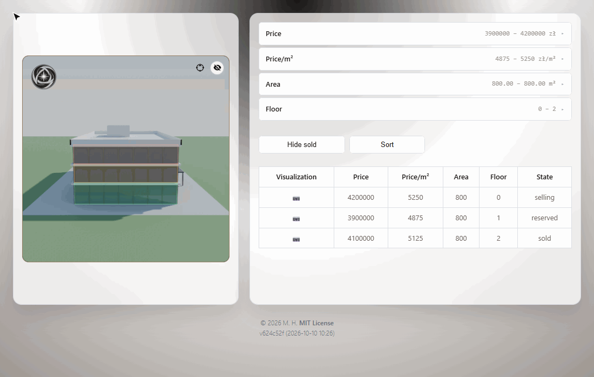

# ArchiModel

Interactive 360° viewer for residential developments. Rotate a rendered model of the building, see every apartment highlighted on it, and browse, filter and sort them in a synced table.

<!-- Replace with a recording of the viewer, see doc/media/README.md -->


## Features

- **360° model view** - pre-rendered frames of the building played with SpriteSpin, rotated by dragging.
- **Apartment overlays** - each apartment is drawn on top of the render and colored by status (available / reserved / sold). Overlays follow the rotation and hide when occluded.
- **Two-way highlighting** - hovering an apartment on the model highlights its row in the table, and hovering a row highlights the apartment on the model.
- **Details on click** - clicking an apartment opens a modal with its price, price per m², area, floor and status.
- **Filtering and sorting** - range filters for price, price per m², area and floor, a toggle for sold units, and sorting. Filters apply to the model too.
- **Compass** that rotates with the view, plus a button to show or hide all overlays.
- **i18n** - English and Polish.
- **Responsive layout** for desktop and mobile.

## How it works

```text
3D model (3ds Max)
  ├── renders from N cameras ──► render_webp.zip ──► 360° view (SpriteSpin)
  └── export to FBX ──► precompute-layer-overlays.mjs ──► layer-overlays.json ──► SVG overlays
apartments.json ───────────────────────────────────────────────────────────────► table + overlay colors
```

1. The building is modelled in 3ds Max. Every apartment is a separate layer (for example `kondygnacja_01`).
2. Frames are rendered from a ring of cameras and packed into a ZIP of `.webp` images. The browser downloads and unpacks it with `fflate`.
3. The same scene, with the cameras, is exported to FBX. The preprocessing script projects every apartment layer through every camera with three.js, computes its 2D outline, checks occlusion and saves the result to `layer-overlays.json`.
4. `apartments.json` holds the sales data. Each apartment points to its model layer through `layer_name`.
5. Netlify Functions serve the data, the logo and the renders. The frontend is plain JavaScript bundled with webpack.

## Tech stack

- Vanilla JavaScript, HTML and CSS bundled with webpack and Babel
- [SpriteSpin](https://github.com/giniedp/spritespin) for the 360° view, [fflate](https://github.com/101arrowz/fflate) for unpacking renders
- [three.js](https://threejs.org/) (FBX/OBJ loaders) for overlay preprocessing in Node
- Netlify (hosting + Functions), Cloudflare R2 for static assets

## Getting started

Requirements: Node.js 18+ and the [Netlify CLI](https://docs.netlify.com/cli/get-started/) (`npm i -g netlify-cli`).

```bash
npm install
npm run dev     # Netlify Dev + webpack watch with live reload
npm run build   # production build into dist/
```

## Using your own model

1. **Renders** - render the building from evenly spaced cameras, export the frames as `.webp` (sorted by file name), zip them and host the archive. Set its URL in [netlify/functions/renders-zip.js](netlify/functions/renders-zip.js).
2. **Overlays** - export the scene with the same cameras to FBX and run:

   ```bash
   node scripts/precompute-layer-overlays.mjs --camerasFbx "data/model.fbx" --fovDeg 73 --occlusionEps 2
   ```

   - `--fovDeg` - camera field of view. It must match the renderer so overlays line up with the frames.
   - `--occlusionEps` - occlusion tolerance, which controls when a layer counts as visible.
   - `--listCameraCandidates` - lists cameras found in the FBX file.
   - `--out`, `--width`, `--height`, `--apartments` - output path, frame size, apartments file.

   Supported inputs are `.fbx` and `.obj`. The native 3ds Max `.max` format can't be read and has to be exported first. Source models go in `data/`, which is git-ignored.
3. **Apartments** - edit [netlify/functions/apartments.json](netlify/functions/apartments.json):

   ```json
   {
     "name": "Apartment A1",
     "price": 2500000,
     "price_per_square_metre": 27778,
     "area": 90,
     "floor": 1,
     "state": "selling",
     "layer_name": "kondygnacja_01"
   }
   ```

   `state` is one of `selling`, `reserved`, `sold`.
4. **Logo** - set the logo URL in [netlify/functions/logo.js](netlify/functions/logo.js).

## Project structure

```text
src/                 frontend (index.html, style.css, js/, i18n/, assets/)
netlify/functions/   API endpoints and the JSON data they serve
scripts/             overlay preprocessing, version generation, PNG to SVG converter
scripts/blender/     procedural test model (office building) with renders and cameras
doc/                 requirements and architecture notes (Polish)
```

## License

[MIT](LICENSE) © 2026 Michał Huras
